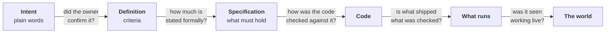
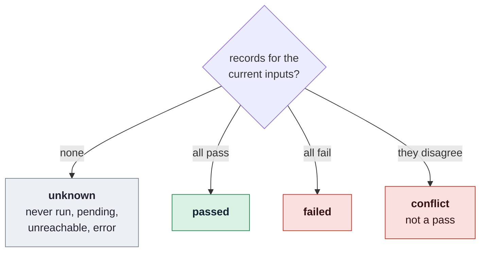
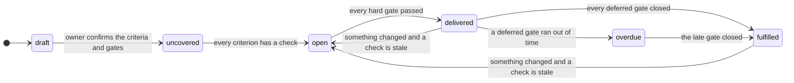
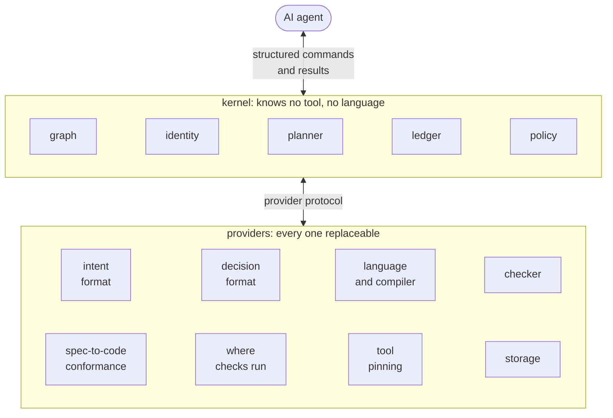
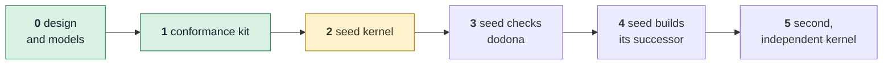

# dodona

[](https://github.com/sloik/dodona/actions/workflows/checks.yml?query=branch%3Amain)
[](https://github.com/sloik/dodona/actions/workflows/models.yml?query=branch%3Amain)
[](LICENSE)

**Was what was defined actually built and delivered, and how sure is that?**

dodona is a tool an AI agent can ask that question, so nobody has to take the agent's word for it. It is built for agents, including less capable ones.

> In the myth, the Argo carried a beam of oak from Dodona in its prow. The beam could speak, and it told the crew the truth.

| | |
|---|---|
| **Stage** | Early. A first seed kernel exists and does only what the conformance kit can judge. dodona is not usable yet |
| **Exists** | Architecture, data model, 25 proposed decisions, protocol schemas, nine formal models, a conformance kit, a seed kernel |
| **Runs** | The seed kernel is built and judged by the kit on macOS, Linux and Windows on every change: 51 scenarios, 96 encoding and path vectors, and 37 planted defects the kit must reject. That is sampled evidence, not proof |
| **Checked so far** | 6 of 36 design claims, by a bounded model check of a small instance. That says nothing yet about any implementation; see [the claims table](spec/CLAIMS.md) |
| **Guarded by** | Automatic checks on every change: a gap that is found becomes a check ([list](docs/gap-checks.md)) |
| **Wanted** | People and agents to break the design, bring tools and bring use cases: [CONTRIBUTING.md](CONTRIBUTING.md) |

## The chain dodona watches

Work starts as plain words and ends as something running. Meaning can be lost at every step. dodona keeps the steps linked and says how strong each link is.



The links that evidence can show (the last three) get a level from one scale, strongest first:

| Level | Meaning |
|---|---|
| `proven` | Shown for all cases |
| `bounded` | Shown for all cases within stated limits |
| `sampled` | Shown for some cases, with the count |
| `observed` | Seen working live |
| `asserted` | Someone says so, and dodona records who |
| `none` | Nothing behind it |

**The score is the weakest link, never an average.** A chain is as strong as its weakest part, and dodona shows which part that is.

The first two links are judgements no tool can make: whether the criteria say what was meant, and whether a check really tests its criterion. dodona does not pretend to. It records whose word each one is and whether that party is independent of the work.

The status is never one word. Every result leads with the whole picture:

```
delivered · gates: 4 hard, 1 soft, 1 deferred (open)
          · shown: bounded (weakest link: specification → code)
          · agreed: criteria confirmed by the owner; checks matched by a reviewer
          · separation: helper (claims apart), 0 of 6 acts apart or better
          · exceptions: 1
```

## Only a pass is a pass

A check that was queued, timed out or could not start is reported as exactly that. And a pass never outranks a failure recorded for the same inputs.



When something changes, only the checks that depended on it become stale and run again. Everything else keeps its recorded result.

## Refuse by default, with honest ways through

Unproven work is not reported as delivered. But some things can only be seen on a live system, some cannot be mocked, and some results vary from run to run. Each criterion therefore has a gate, declared up front:

| Gate | Blocks delivery? | For |
|---|---|---|
| **Hard** (default) | Yes | Anything that can be checked before delivery |
| **Soft** | No, but lowers the stated level | Useful signals that should not stop work |
| **Deferred** | No, but blocks *fulfilled* | What can only be checked after delivery, by a stated limit |



Nobody sets these states by hand. They follow from evidence. An intent with no hard gate is reported as `unguarded` and can never be delivered, so declaring everything soft is not a way through.

**Exceptions leave a mark.** Changing a criterion or loosening a gate is a recorded amendment, granted only by the owner of the intent, human or agent. Best practice: the one who grants an exception is never the one whose work is being judged.

## How separate was the checker?

Agents can and should start other agents to check their work. dodona cannot make a checker independent, and does not pretend to. It grades how separate the checker was, and shows the grade next to every result:

| Level | Meaning |
|---|---|
| `self` | The worker checked its own work, or nothing is recorded |
| `helper` | Someone else, but started, briefed or informed by the worker |
| `apart` | A fresh session that saw only the work and the criteria |
| `tested` | Apart, and it told a known-wrong case from a known-right one |
| `cross-make` | Tested, and a different model family or vendor |
| `credentialed` | Signed with a credential the worker cannot create (not available yet) |

Nothing recorded means `self`. A project sets the lowest level at which an exception or a confirmation counts.

**A claim is not a grade.** An agent can write down that its checker was separate. dodona shows the claim and caps the grade by who stands behind the facts: a say-so earns `helper` at most, and anything higher needs a signature from something the working agent does not control. Nothing can provide that yet, so today the highest grade is `helper`, shown as `helper (claims apart)`. A review showed a lone agent could otherwise have claimed the fifth level of six.

## Nothing is built in

dodona chooses no tools. The kernel knows no language and no checker; every other part is a separate, replaceable program, and a project mixes them freely.



- **Bring your own** decision-record format, specification language, model checker or prover, test runner and compiler.
- **Same answers on every platform.** A committed lock pins every tool by digest per platform. macOS first, then Linux, then Windows.
- **dodona judges; it does not plan or do the work.**

## Built with itself

No implementation language is chosen. dodona's own intents, decisions and formal specification are the source of truth; a kernel is a derived artifact that must conform to them, and can be replaced by another that also conforms.



The project is at stage 2, in a small way: a first seed, written by a different make of AI model from the one that wrote the kit, passes the kit. It covers only what the formal models cover. A kernel checking itself adds no trust in itself; that is what the independent second kernel is for.

## Where to go next

| If you want | Read |
|---|---|
| The design | [ARCHITECTURE.md](ARCHITECTURE.md) |
| The terms and rules, precisely | [MODEL.md](MODEL.md) |
| What dodona is meant to do, as a roadmap | [intents/](intents/README.md) |
| Why it is designed this way | [decisions/](decisions/README.md) |
| What has actually been checked | [spec/CLAIMS.md](spec/CLAIMS.md) |
| How providers talk to the kernel | [protocol/](protocol/README.md), [writing a provider](docs/writing-a-provider.md) |
| How a project is configured | [docs/configuration.md](docs/configuration.md) |
| What a correct kernel must do | [conformance/](conformance/README.md) |
| The first kernel | [kernel/](kernel/README.md) |
| What reviewers found wrong | [docs/reviews/](docs/reviews/2026-11-17-draft-0.1.md) |
| To take part | [CONTRIBUTING.md](CONTRIBUTING.md) |
| Rules for agents working here | [AGENTS.md](AGENTS.md) |

## Licence

[MIT](LICENSE)
