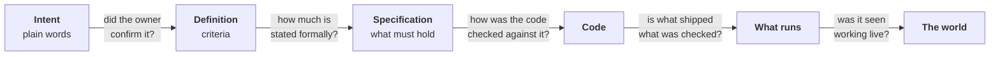
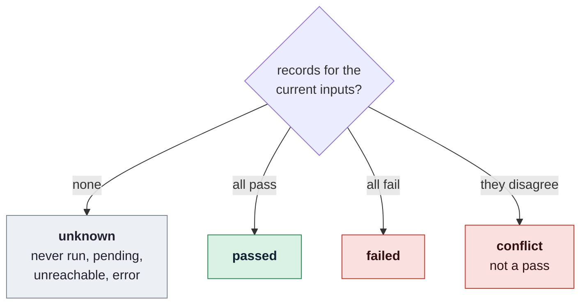
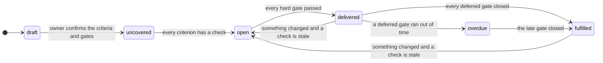
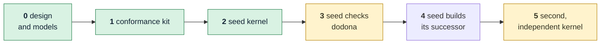

# dodona

[](https://github.com/sloik/dodona/actions/workflows/checks.yml?query=branch%3Amain)
[](https://github.com/sloik/dodona/actions/workflows/models.yml?query=branch%3Amain)
[](LICENSE)

**Was what was defined actually built and delivered, and how sure is that?**

dodona is a tool an AI agent can ask that question, so nobody has to take the agent's word for it. It is built for agents, including less capable ones.

> In the myth, the Argo carried a beam of oak from Dodona in its prow. The beam could speak, and it told the crew the truth.

| | |
|---|---|
| **Stage** | Early. Two seed kernels exist and do only what the conformance kit can judge. dodona is not usable yet |
| **Exists** | Architecture, data model, 34 proposed decisions, protocol schemas, nine formal models, a conformance kit, two seed kernels written apart, a first real provider, a ledger format |
| **Runs** | Both kernels are built and judged on macOS, Linux and Windows on every change: 150 scenarios, 119 encoding, path and key vectors, and 89 ledger checks including damage at every byte and two kernels writing at once. The kit lists 594 planted defects, 275 in one kernel and 319 in the other. A complete rerun of that inventory is pending. The two are then compared on a thousand inputs the kit does not contain, with steps reshuffled and values changed. A reference harness really starts a checker, and both kernels grade what it signs. Both kernels also host providers themselves: 22 cases of a misbehaving provider session and 132 of a misbehaving checker, judged from what the provider and the executor record of what the host sent them, against what the contract says it must send. A host written to forge those records is not caught ([decision 0033](decisions/0033-a-kernel-hosts-providers.md)). That is sampled evidence, not proof |
| **Checked so far** | 23 of 37 design claims are marked checked: every case of every model ran to its end in one completed job on the shared queue and showed what it was expected to (run 9; the repaired liveness model, run 10). Issue 27 repaired the models so that each keeps a specification apart from a kernel and carries planted defects for both directions, and settled the three places where a model departed from the design text ([decision 0030](decisions/0030-the-hard-gate-floor-is-counted-over-the-tree.md) and [0031](decisions/0031-an-agreement-after-a-real-change-keeps-its-grade-up-to-a-limit.md), both by owner direction, and [0032](decisions/0032-a-stand-in-is-verified-for-its-own-key-and-any-disagreement-withdraws-it.md)); the seventh, liveness, gained the direction its property did not check. **Some properties still restate their rule**: where the specification and the kernel compute the same thing from equal values, the claims table says so, and there "checked" means the rule is written down exactly and each planted defect is caught, not that the rule is right ([claims](spec/CLAIMS.md)). Run 9 found agreement on about 150,000 states for the earlier kernel sources. The comparison needs a fresh run for the current sources. 6 more claims are sampled by the kit and not counted |
| **dodona on dodona** | On every change to `main`, a provider describes dodona's own model checks, the results go into a ledger, and a kernel works out the status of this project from it. Today the 94 model checks are recorded as passed, and the status is still `draft` for every intent and `unknown` for the project: nobody has confirmed the criteria in a way a kernel can read, and most criteria are not yet checked by anything a kernel can read. That is the honest answer, and changing it is the owner's act, not an agent's |
| **Guarded by** | Automatic checks on every change: a gap that is found becomes a check ([list](docs/gap-checks.md)) |
| **Wanted** | People and agents to break the design, bring tools and bring use cases: [CONTRIBUTING.md](CONTRIBUTING.md) |

## Roadmap: where we are

dodona is bootstrapped in six stages ([decision 0011](decisions/0011-self-hosting-through-a-verified-seed.md)). Each stage says what it establishes and what it does not.

| Stage | What it means | Where it is |
|---|---|---|
| **0. Design and models** | The rules are written down and checked by a model checker before any kernel exists | **Done**, with a caveat: every model ran to its end on the shared queue, but some properties still restate their rule ([claims](spec/CLAIMS.md)) |
| **1. Conformance kit** | Scenarios, vectors and planted defects that judge any kernel, written apart from the kernels | **Done**, and growing with every round of review ([conformance/](conformance/README.md)) |
| **2. Seed kernel** | A first kernel that passes the kit | **Done** ([kernel/](kernel/README.md)) |
| **3. The seed checks dodona** | dodona's own obligations are run, recorded in a ledger and reported on by a kernel | **In progress.** It runs on every change to `main`, but through stage-0 helpers in Python. Next: the kernels run the pipeline and the status command themselves |
| **4. The seed builds its successor** | A kernel built and checked by dodona, which rebuilds itself | Not started |
| **5. A second, independent kernel** | Written apart from the first, so a defect must be in both to go unnoticed | **In progress.** It exists, passes the same kit and is compared with the first on every change ([kernel2/](kernel2/README.md)); one exposure between the authors is recorded below |

### Now, in order

| Step | Status |
|---|---|
| The owner confirms an intent's criteria and gates, recorded in a ledger in the repository | Done |
| Checks that already have a current result are reused between CI runs, with the counts shown | Done ([issue 22](https://github.com/sloik/dodona/issues/22)) |
| The formal models repaired so each property can fail, with planted defects both ways | Done ([issue 27](https://github.com/sloik/dodona/issues/27)) |
| A kernel hosts providers itself: a provider session and one check to a verdict | Done ([decision 0033](decisions/0033-a-kernel-hosts-providers.md), first step; [PR 36](https://github.com/sloik/dodona/pull/36)) |
| A kernel runs the whole pipeline and answers one status command an agent can run, replacing the Python helpers | In progress ([decision 0034](decisions/0034-a-kernel-runs-a-project-and-reports-its-status.md), proposed, on branch `kernel-run`) |
| A second real provider of another kind, a test runner, end to end into the ledger and the status | After that |
| Checks that documentation follows code, and a metrics ratchet, on every pull request | In review, on their own branches |

### Not planned yet

Intent trees deeper than one level ([issue 32](https://github.com/sloik/dodona/issues/32)), a planner that does not take a test's truth from the build key ([issue 33](https://github.com/sloik/dodona/issues/33)), a harness the working agent cannot reach ([issue 26](https://github.com/sloik/dodona/issues/26)), and stage 4. What each intent asks for is in [intents/](intents/README.md).

## The chain dodona watches

Work starts as plain words and ends as something running. Meaning can be lost at every step. dodona keeps the steps linked and says how strong each link is.



The links that evidence can show (the last three) get a level from one scale, strongest first:

| Level | Meaning |
|---|---|
| `proven` | Shown for all cases |
| `bounded` | Shown for all cases within stated limits |
| `sampled` | Shown for some cases, with the count |
| `observed` | Seen working live |
| `asserted` | Someone says so, and dodona records who |
| `none` | Nothing behind it |

**The score is the weakest link, never an average.** A chain is as strong as its weakest part, and dodona shows which part that is.

The first two links are judgements no tool can make: whether the criteria say what was meant, and whether a check really tests its criterion. dodona does not pretend to. It records whose word each one is and whether that party is independent of the work.

The status is never one word. Every result leads with the whole picture:

```
delivered · gates: 4 hard, 1 soft, 1 deferred (open)
          · shown: bounded (weakest link: specification → code)
          · agreed: criteria confirmed by the owner; checks matched by a reviewer
          · separation: helper (claims apart), 0 of 6 acts apart or better
          · exceptions: 1
```

## Only a pass is a pass

A check that was queued, timed out or could not start is reported as exactly that. And a pass never outranks a failure recorded for the same inputs.



When something changes, only the checks that depended on it become stale and run again. Everything else keeps its recorded result. dodona does this to itself: each run on `main` starts from the ledger the last one kept, and a change that touches no model sends nothing to the shared queue.

## Refuse by default, with honest ways through

Unproven work is not reported as delivered. But some things can only be seen on a live system, some cannot be mocked, and some results vary from run to run. Each criterion therefore has a gate, declared up front:

| Gate | Blocks delivery? | For |
|---|---|---|
| **Hard** (default) | Yes | Anything that can be checked before delivery |
| **Soft** | No, but lowers the stated level | Useful signals that should not stop work |
| **Deferred** | No, but blocks *fulfilled* | What can only be checked after delivery, by a stated limit |



Nobody sets these states by hand. They follow from evidence. An intent with no hard gate is reported as `unguarded` and can never be delivered, so declaring everything soft is not a way through.

**Exceptions leave a mark.** Changing a criterion or loosening a gate is a recorded amendment, granted only by the owner of the intent, human or agent. Best practice: the one who grants an exception is never the one whose work is being judged.

## How separate was the checker?

Agents can and should start other agents to check their work. dodona cannot make a checker independent, and does not pretend to. It grades how separate the checker was, and shows the grade next to every result:

| Level | Meaning |
|---|---|
| `self` | The worker checked its own work, or nothing is recorded |
| `helper` | Someone else, but started, briefed or informed by the worker |
| `apart` | A fresh session that saw only the work and the criteria |
| `tested` | Apart, and it told a known-wrong case from a known-right one |
| `cross-make` | Tested, and a different model family or vendor |
| `credentialed` | Signed with a credential the worker cannot create (not available yet) |

Nothing recorded means `self`. A project sets the lowest level at which an exception or a confirmation counts.

**A claim is not a grade.** An agent can write down that its checker was separate. dodona shows the claim and caps the grade by who stands behind the facts: a say-so earns `helper` at most, and anything higher needs a signature from something the working agent does not control. The way to vouch now exists: a reference harness starts the checker itself, tests it on a known-wrong case, and signs what it did with a keyed check value that both kernels verify against the project's protected policy. What does not exist is a harness the working agent cannot reach: the reference reads its key from a file. So for dodona's own work the highest grade is still `helper`, shown as `helper (claims apart)`. A review showed a lone agent could otherwise have claimed the fifth level of six.

## Nothing is built in

dodona chooses no tools. The kernel knows no language and no checker; every other part is a separate, replaceable program, and a project mixes them freely.


- **Bring your own** decision-record format, specification language, model checker or prover, test runner and compiler.
- **Same answers on every platform.** A committed lock pins every tool by digest per platform. macOS first, then Linux, then Windows.
- **dodona judges; it does not plan or do the work.**

## Built with itself

No implementation language is chosen. dodona's own intents, decisions and formal specification are the source of truth; a kernel is a derived artifact that must conform to them, and can be replaced by another that also conforms.



Where each stage stands is in the [roadmap](#roadmap-where-we-are) above. The project is between stages. A first seed in Rust and a second in JavaScript pass the same kit. The second was written without sight of the first, from the documents alone. Run on dodona's own repository, the seed reports honestly that nothing is delivered yet. A kernel checking itself adds no trust in itself; that is what the second kernel is for, and the two are compared on every change.

What makes a second opinion worth having is a fresh context: an author or a checker that has not seen the work it is judged against, and so cannot lean on it. That is what dodona asks for and grades. A different make of model is not required. Whether to use one is the user's choice, where it raises the odds of catching a shared blind spot. Here, the kit and both kernels were written by the same make of model, each kernel by an agent that never saw the other; the first kernel was begun by a different make. One exception is recorded: while the kernels' hosts were reworked (decision 0033), a scratch folder shared by mistake showed the first kernel's author, after it had written its host, a list of the second kernel's planted defects that quotes lines of that kernel's host code. Two planted defects it added afterwards resemble entries in that list. Each author now has a folder of its own.

## Where to go next

| If you want | Read |
|---|---|
| The design | [ARCHITECTURE.md](ARCHITECTURE.md) |
| The terms and rules, precisely | [MODEL.md](MODEL.md) |
| What dodona is meant to do, as a roadmap | [intents/](intents/README.md) |
| Why it is designed this way | [decisions/](decisions/README.md) |
| What has actually been checked | [spec/CLAIMS.md](spec/CLAIMS.md) |
| The project in numbers, and which of them may only go up | [docs/metrics.md](docs/metrics.md) |
| How providers talk to the kernel | [protocol/](protocol/README.md), [writing a provider](docs/writing-a-provider.md) |
| How a project is configured | [docs/configuration.md](docs/configuration.md) |
| What a correct kernel must do | [conformance/](conformance/README.md) |
| The two kernels | [kernel/](kernel/README.md), [kernel2/](kernel2/README.md) |
| The first real provider, and how its results reach a status | [providers/tlc/](providers/tlc/provider.py), [decision 0026](decisions/0026-the-first-host-and-status-are-stage-0-helpers.md) |
| What reviewers found wrong | [docs/reviews/](docs/reviews/2026-11-18-rewritten-models.md) |
| To take part | [CONTRIBUTING.md](CONTRIBUTING.md) |
| Rules for agents working here | [AGENTS.md](AGENTS.md) |

## Licence

[MIT](LICENSE)
